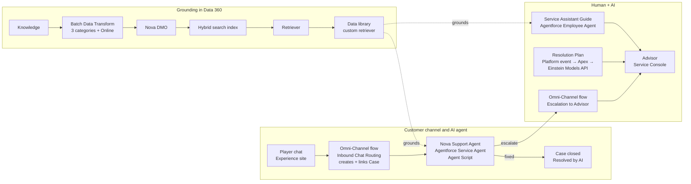

# Agent-first Player Support with Agentforce

An AI agent answers every player chat, hands the conversation to a human when it matters, and then coaches that human to resolution. Built on Salesforce Service Cloud, Agentforce and Data 360.

*Nova Games is a fictional brand. This is a re-creation, in a Developer Edition org, of an agent-first support pattern delivered for a global gaming client. No client data is included.*

---

## What it does

| Path | Example | Outcome on the Case |
|---|---|---|
| **AI only** | "My 1,000 gems never showed up" | Agent collects player ID + platform, answers from Knowledge, closes the case as **Resolved by AI** |
| **AI → human** | "Someone hacked my account" | Intake only, then hand-off with an AI summary, reason **Account security**, priority **High** |
| **Human + AI** | Advisor accepts the escalated chat | A **Resolution Plan** is already on the case; an AI guide gives the next step and ticks progress |

---

## Architecture

**Key design decisions**
- **Agent first, human when it matters**: every chat reaches the agent; sensitive issues always go to a person.
- **Deterministic gates in Agent Script**: troubleshooting, resolution and escalation unlock only after intake is saved (`available when @variables.intakeDone == True`).
- **IDs from context, never from the LLM**: the Case ID is linked from the Messaging Session.
- **Curated grounding**: a Batch Data Transform filters Knowledge *before* indexing (only published articles in the support categories). The standard Knowledge library indexed **33 chunks** (including drafts and unselected categories); the curated index holds **6**.
- **Least privilege**: the customer-facing agent runs as a locked-down agent user. Plan generation is event-driven (`Nova_Plan_Request__e`) and its subscriber runs as an integration user.
- **Everything lands on the Case**: Player ID, Platform, Category, AI Summary, Escalation Reason, Priority, Resolution Plan, Resolved by AI. That makes the outcome measurable.

---

## Repository layout

| Path | Contents |
|---|---|
| `force-app/main/default/aiAuthoringBundles/` | Agent Script for **Nova Support Agent** (Service Agent) and **Service Assistant Guide** (Employee Agent) |
| `force-app/main/default/flows/` | 2 Omni-Channel routing flows, 4 agent-action flows, 1 record-triggered flow |
| `force-app/main/default/classes/` | `NovaCaseGuide` (case + Knowledge context), `NovaResolutionPlanService` (Einstein Models API), tests |
| `force-app/main/default/triggers/` | `NovaPlanRequestTrigger` (platform event subscriber) |
| `force-app/main/default/objects/` | Case fields, Knowledge `Answer__c`, platform event `Nova_Plan_Request__e` |
| `force-app/main/default/…` | Messaging channel, Embedded Service deployments, presence config, permission set, data category group, Experience site |
| `scripts/agent/` | Generator for the Nova agent script (stamps out the three Knowledge topics) |
| `data/` | Sample Knowledge articles (support + deliberately irrelevant "Company News") |
| `docs/` | Solution overview, line-by-line Agent Script guide, Batch Data Transform → retriever runbook |

---

## Test results (live conversations, real actions)

| Input | Expected | Result |
|---|---|---|
| "I bought 1,000 gems… never showed up" → ID + platform → "that worked" | AI resolves | Platform-specific steps; case **Closed, Resolved by AI** ✅ |
| "Someone hacked my account" → ID + platform | Hand-off, no AI troubleshooting | **Escalated, Account security, High**, AI summary ✅ |
| "I want a real person", refuses details | Never trap the player | Asked once, then escalated ✅ |
| Escalated account-security case | Plan before the advisor says hello | 6-step plan in ≈10 s; guide ticks step 1 ✅ |
| Advisor: "When is the esports championship final?" (Company News) | Not answered | Before curated grounding: answered (leak). After: "not in our knowledge articles" ✅ |
| "Season 5 battle pass rewards?" (draft article) | Drafts never reach the AI | "Our knowledge articles do not list…" ✅ |

---

## Deploying to your own org

Prerequisites: an org with Service Cloud, Messaging for In-App and Web, Omni-Channel, Lightning Knowledge, Data 360 and Agentforce enabled; Salesforce CLI v2.

1. Replace the placeholders (`your-domain…`, `integration.user@example.com`, `nova_support_agent@your-org.ext`, `<ORG_ID>`) with your org's values.
2. Deploy the data model, flows and Apex: `sf project deploy start -d force-app -o <alias>`.
3. Load the sample articles from `data/` and publish them.
4. In Data 360, build the Batch Data Transform → search index → retriever → data library (see `docs/BDT-RETRIEVER-RUNBOOK.md`), then set its ID in the agent scripts' `knowledge.rag_feature_config_id`.
5. Validate, preview and publish the agents:
   `sf agent validate authoring-bundle --api-name Nova_Support_Agent`
   `sf agent publish authoring-bundle -n Nova_Support_Agent`
   `sf agent activate -n Nova_Support_Agent`
6. Point your Messaging channel's routing at `Nova_Inbound_Chat_Routing`.

---

## Built with
Agentforce (Agent Script, Service Agent, Employee Agent) · Omni-Channel flows · Data 360 (Batch Data Transform, hybrid search index, retriever, data library) · Einstein Models API · Einstein Trust Layer · Apex · Salesforce CLI · Claude Code (AI coding assistant)

**Author:** Thevendra Pandian Achuthan, Technical Architect · Agentforce Specialist
